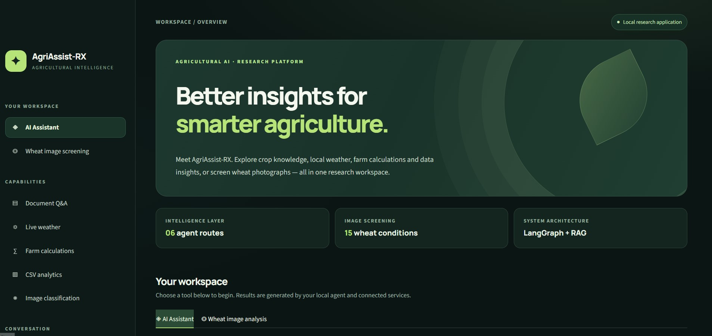
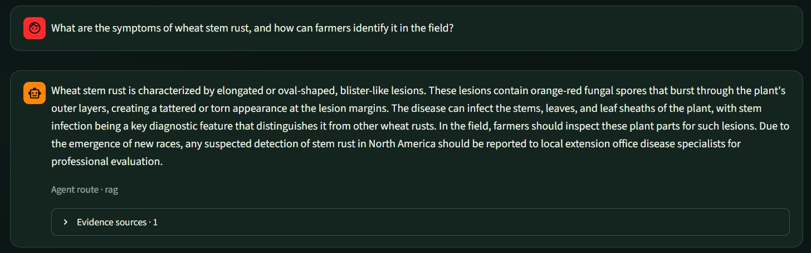
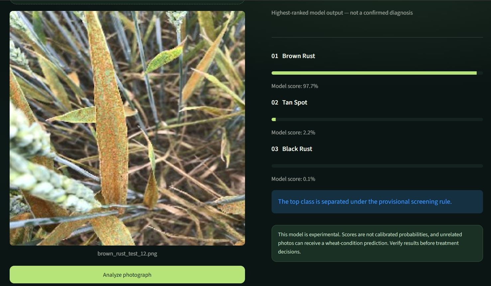
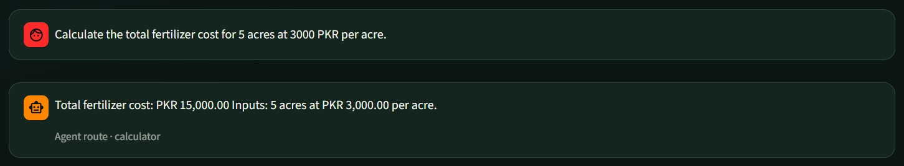
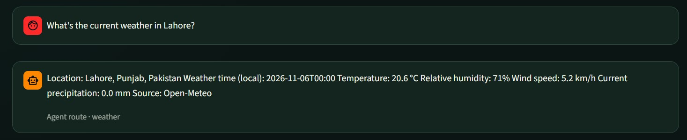
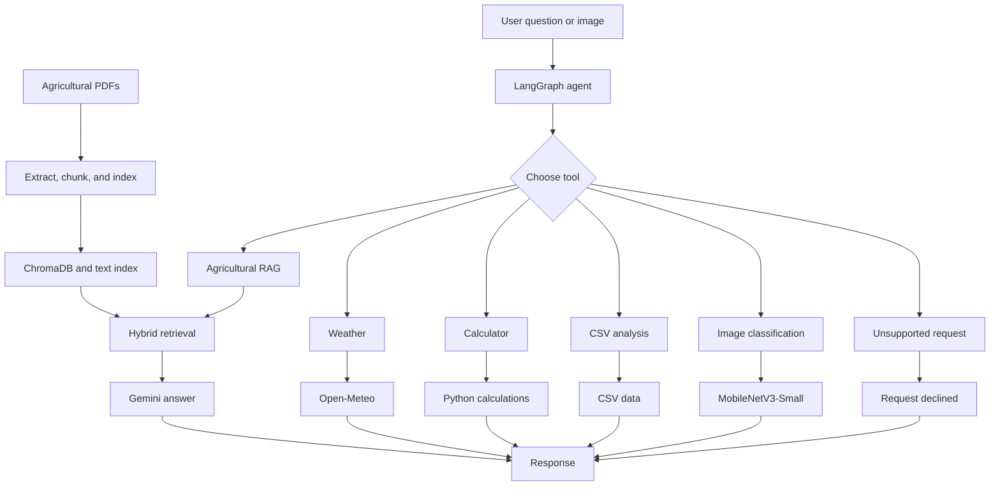

# AgriAssist-RX

### Agricultural AI Assistant | Python · LangGraph · RAG · Computer Vision · Streamlit

AgriAssist-RX is a Python project that brings agricultural questions, weather information, farm calculations, crop data analysis, and wheat image classification into one application.

I built it to explore how AI agents, document retrieval, and computer vision can work together. Rather than using a separate program for each task, the assistant selects a tool based on the user's question.

The project runs through a Streamlit web interface or in the terminal. It has six working routes, along with tests for tool selection, answer quality, image classification, and error handling.

**Project status:** Working research prototype.

## Application Demo

The Streamlit interface brings the tools into one workspace. Users can ask questions, view document sources, and upload wheat photographs for screening.

### Main Dashboard



### Agricultural Question Answering

The RAG system searches agricultural documents and displays source references with its answers.



### Wheat Image Classification

The image tool shows the three highest-ranked wheat conditions and their model scores. These scores are not confirmed diagnostic probabilities.



### Farm Calculator

The calculator uses the values and units provided by the user.



### Weather Information

The weather tool retrieves current conditions from Open-Meteo.



## Features

| Feature | What it does |
|---|---|
| Agricultural RAG | Answers questions using information from wheat disease documents |
| Weather | Checks current weather for supported locations |
| Farm calculator | Calculates fertilizer, seed, irrigation, and crop production quantities |
| CSV analysis | Reads crop data and calculates basic statistics |
| Image classification | Predicts wheat conditions from photographs |
| Request handling | Rejects questions outside the available tools and reports routing errors |

The agent chooses a tool automatically. Users can enter a question in the chat interface or use the image upload section for wheat photographs.

## System Architecture

The project uses LangGraph to connect the six routes.



For agricultural questions, the RAG system searches a local collection of PDF documents. It combines semantic search and BM25 keyword matching to find relevant text. Gemini then prepares an answer using the retrieved information.

Image classification works differently. A fine-tuned MobileNetV3-Small model examines the photograph and predicts the highest-ranked wheat conditions.

Calculations use the numbers provided by the user. The application checks for missing values, invalid inputs, and some incompatible units.

## Results

I tested each part of the project before combining the tools into one agent.

| Evaluation | Result |
|---|---|
| Agent routing | 60/60 correct after retries |
| First-attempt routing completion | 54/60 |
| RAG answer review | 28/30 passed |
| Hybrid retrieval Hit@3 | 100% on 3 questions |
| Wheat image classification | 83.73% accuracy |
| Image classification macro-F1 | 0.8112 |
| Agent integration | 6/6 basic tests passed |

These are results from separate evaluations. They don't represent one overall accuracy score. The routing results measure tool selection, not the quality of every answer.

### Agricultural Question Answering

The RAG knowledge base contains four documents about wheat rust diseases. These were processed into 38 text chunks.

I reviewed the assistant's answers to 30 new questions. Twenty-eight passed the manual review. One was partly correct, and another included a claim that wasn't directly supported by its source.

Hybrid retrieval also performed better than dense search and BM25 in an initial three-question comparison. That test is too small to prove it will always perform better.

### Wheat Image Classification

I fine-tuned MobileNetV3-Small to recognize 15 wheat conditions, including diseases, pests, and healthy plants.

The model was evaluated on an internal grouped test set containing 1,051 images.

| Metric | Result |
|---|---:|
| Test images | 1,051 |
| Correct predictions | 880 |
| Test accuracy | 83.73% |
| Macro-F1 | 0.8112 |
| Classes | 15 |

The model performed best on Fusarium head blight and yellow rust. Tan spot, leaf blight, and black rust were more difficult to classify.

Duplicate and similar images were considered during dataset preparation. However, some similar images may remain. The model hasn't been tested on an independent collection of farm photographs.

The full test results, methods, and known issues are recorded in the [Evaluation Report](docs/EVALUATION.md).

## Example

The calculator can answer questions using values provided by the user.

**Question**

> Calculate the fertilizer quantity for 5 acres at 2 bags per acre.

**Answer**

> Fertilizer required: 10 bags.

It also supports fertilizer costs expressed per acre or per bag. For example:

**Question**

> Calculate fertilizer cost for 5 acres at 3000 PKR per acre.

**Answer**

> Total fertilizer cost: PKR 15,000.00. Inputs: 5 acres at PKR 3,000.00 per acre.

The calculator rejects invalid inputs. During testing, a negative farm area produced this message:

> Calculation error: Area must be greater than zero.

These checks were improved after earlier tests showed problems with negative signs and fertilizer cost units.

## Tools Used

| Tool | Purpose |
|---|---|
| Python | Main application |
| Streamlit | Web interface |
| LangGraph | Agent workflow |
| Google Gemini | Tool routing and answer generation |
| ChromaDB | Local vector database |
| Sentence Transformers | Text embeddings |
| BM25 | Keyword search |
| PyMuPDF | PDF processing |
| PyTorch | Image model training and inference |
| MobileNetV3-Small | Wheat image classification |
| Scikit-learn | Model evaluation |
| Requests | API communication |

## Project Structure

```text
AgriAssist-RX/
│
├── .streamlit/
│   └── config.toml
│
├── data/
│   └── crop_production.csv
│
├── docs/
│   ├── EVALUATION.md
│   ├── SETUP.md
│   └── screenshots/
│       ├── dashboard.jpg
│       ├── rag_demo.jpg
│       ├── vision_demo.jpg
│       ├── calculator_demo.jpg
│       └── weather_demo.jpg
│
├── eval/
│   ├── results/
│   ├── vision/
│   ├── evaluate_agent_unseen.py
│   ├── evaluate_rag_unseen.py
│   └── evaluate_vision_final.py
│
├── src/
│   ├── agent_csv.py
│   ├── agent_calculator.py
│   ├── agent_vision.py
│   ├── rag.py
│   ├── retriever.py
│   ├── vision_tool.py
│   ├── weather_tool.py
│   ├── csv_tool.py
│   └── calculator_tool.py
│
├── app.py
├── main.py
├── requirements.txt
├── README.md
└── LICENSE
```

The `src` folder contains the agent and tool code. The `eval` folder contains testing scripts and saved results. The `docs` folder contains the setup guide, evaluation report, and screenshots. The Streamlit interface is in `app.py`.

## Installation

For full setup instructions, see the [Setup Guide](docs/SETUP.md).

The project was developed on Windows using VS Code and a Python virtual environment.

### 1. Clone the repository

```powershell
git clone https://github.com/Muhammad-Usman-Shah/AgriAssist-RX.git
cd AgriAssist-RX
```

### 2. Create a virtual environment

```powershell
python -m venv .venv
```

### 3. Install the required packages

```powershell
.\.venv\Scripts\python.exe -m pip install -r requirements.txt
```

Streamlit is also needed for the web interface. If it isn't installed through the requirements file, run:

```powershell
.\.venv\Scripts\python.exe -m pip install streamlit==1.66.1
```

### 4. Add a Gemini API key

Create a `.env` file in the main project folder and add:

```env
GEMINI_API_KEY=your_api_key_here
```

Keep your actual API key private.

### 5. Prepare the local resources

The repository doesn't include the original agricultural PDFs, generated ChromaDB database, trained model weights, or wheat image dataset.

The RAG system needs its documents to be processed before it can answer questions. The image classifier also needs the saved checkpoint specified in `src/vision_tool.py`.

The current model path was configured for my Windows development environment. It must be updated when using a different computer.

Package compatibility has been checked in the development environment. A complete installation on a separate computer hasn't been verified yet.

## Run the Assistant

### Streamlit web interface

After preparing the required local files, start the web application:

```powershell
.\.venv\Scripts\python.exe -m streamlit run app.py
```

Streamlit displays the addresses in the terminal. In the current development setup, they are:

**Local URL:** http://localhost:8501  
**Network URL:** http://192.168.18.57:8501

The local URL works on the computer running Streamlit. The network URL may work on another device connected to the same network, if the network and firewall allow it. These are **not public hosted links**. The app must be running, and the network address may change.

The interface has an **AI Assistant** section for text questions and a **Wheat Image Analysis** section for uploading photographs.

### Terminal application

To use the six-route agent in PowerShell instead:

```powershell
.\.venv\Scripts\python.exe main.py
```

The program will ask for a question. Type `exit` to close it.

### Example questions

| Task | Example question |
|---|---|
| Wheat diseases | What are the symptoms of wheat stem rust? |
| Fertilizer | Calculate fertilizer quantity for 5 acres at 2 bags per acre. |
| Weather | What is the weather in Lahore today? |
| CSV | How many rows are in crop_production.csv? |
| Image | Upload a wheat photograph in the Streamlit image analysis section |

For the terminal image tool, use a local image path in the question instead of uploading a file.

## Known Limitations

AgriAssist-RX is an experimental project.

The document collection mainly covers wheat rust diseases. The assistant may not have enough evidence to answer questions outside that topic.

Some generated answers may be incomplete or unsupported by their cited sources. Gemini and weather requests can also fail when external services are unavailable.

The image classifier has been tested on an internal dataset, but its performance on new farm photographs isn't yet known. A high model score doesn't guarantee a correct diagnosis. It also cannot reliably reject unrelated images.

The repository needs local documents and a compatible image-model checkpoint for the full application to work. A clean setup on a second computer still needs testing.

The project should not be used as a substitute for professional agricultural advice.

## Next Steps

I plan to test installation on another computer, add more agricultural documents, improve source checking, and evaluate the image classifier on new field photographs.

I also plan to record a short demonstration of the Streamlit application.

## Author

**Muhammad Usman Shah**

[GitHub Profile](https://github.com/Muhammad-Usman-Shah)

## License

See the [LICENSE](LICENSE) file for the terms of use.
